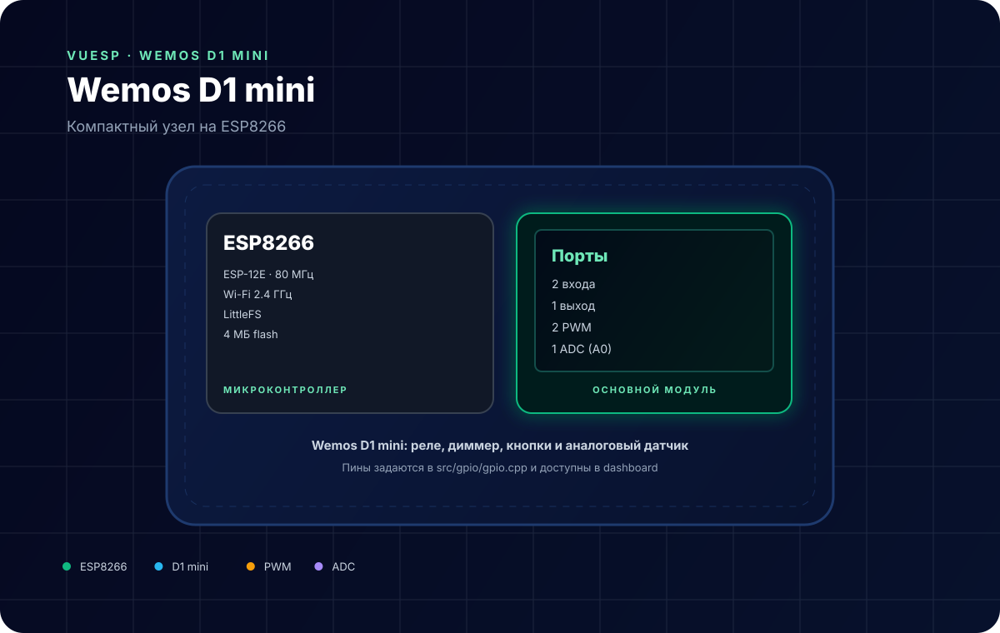
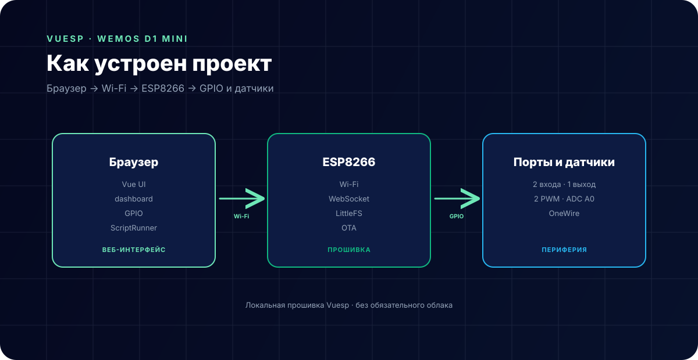

# Wemos D1 mini — компактный узел на ESP8266



**Коротко:** `vuesp.wemos-d1-mini` — прошивка Vuesp для **ESP8266 (ESP-12E / Wemos D1 mini)**. Два входа с подтяжкой, один выход, два PWM и аналоговый вход A0. Подходит для реле, диммера, кнопок и простых датчиков.

## Что это за устройство

Стандартный проект Vuesp на ESP8266:

- локальный веб-интерфейс без облака;
- настройка Wi-Fi, авторизации, GPIO и файловой системы;
- dashboard с плитками;
- ScriptRunner и OTA;
- LittleFS для веб-сборки и файлов.

По умолчанию заняты шесть пинов: два входа, один выход, два PWM и ADC. Остальные GPIO можно добавить в `src/gpio/gpio.cpp`.

## Характеристики

| Параметр | Значение |
| --- | --- |
| Микроконтроллер | ESP8266 (ESP-12E, 80 МГц) |
| Wi-Fi | 802.11 b/g/n, 2.4 ГГц |
| Flash | обычно 4 МБ |
| Логика | 3.3 В |
| ADC | 1 канал, A0 (0…1 В на голом ESP-12E, 0…3.3 В на плате с делителем) |
| Файловая система | LittleFS |
| Версия прошивки | 0.1.1 (`platformio.ini`) |
| Среда | PlatformIO + Arduino |

## Распиновка

| GPIO | Пин ESP12E | Режим | Назначение |
| --- | --- | --- | --- |
| 4 | D2 | `INPUT_PULLUP`, прерывание | кнопка, датчик |
| 5 | D1 | `INPUT_PULLUP`, прерывание | кнопка, датчик |
| 12 | D6 | `OUTPUT` | реле, светодиод |
| 13 | D7 | `PWM` | диммер, вентилятор |
| 14 | D5 | `PWM` | диммер, вентилятор |
| 17 | A0 | `ADC` | аналоговый датчик |

Список портов задаётся в `src/gpio/gpio.cpp`:

```cpp
Port ports[6] = {
    {KEY_PORT, 4, 0, GPIO_MODE_INPUT_PULLUP, GPIO_INTERRUPT_CHANGE, ...},
    {KEY_PORT, 5, 0, GPIO_MODE_INPUT_PULLUP, GPIO_INTERRUPT_CHANGE, ...},
    {KEY_PORT, 12, 0, GPIO_MODE_OUTPUT, ...},
    {KEY_PORT, 13, 255, GPIO_MODE_PWM, ...},
    {KEY_PORT, 14, 0, GPIO_MODE_PWM, ...},
    {KEY_PORT, 17, 0, GPIO_MODE_ADC, ...},
};
```

GPIO 0, 1, 2, 3, 15 и 16 не используются по умолчанию: они отвечают за загрузку, UART и flash.

## Схема подключения

```text
Кнопка:   GPIO4 (D2) ── кнопка ── GND
Кнопка:   GPIO5 (D1) ── кнопка ── GND
Реле:     GPIO12 (D6) ── модуль реле (VCC, IN, GND)
Диммер:   GPIO13 (D7) ── затвор MOSFET / SSR
Диммер:   GPIO14 (D5) ── затвор MOSFET / SSR
Датчик:   A0 ── выход датчика 0…3.3 В
```

> **Важно.**
> - GPIO — 3.3 В. Модуль реле на 5 В подключайте через транзистор/оптопару или берите 3.3-В модуль.
> - A0 на голом ESP-12E рассчитан на 0…1 В. На Wemos D1 mini стоит делитель до 3.3 В — проверьте конкретную плату.
> - Не подавайте 5 В на GPIO.
> - GPIO15 при старте должен быть низким, GPIO0/2 — высокими; не вешайте на них нагрузку.

## Как устроен проект



- `src/device/device.cpp` — стандартное устройство Vuesp;
- `src/gpio/gpio.cpp` — список портов;
- `vue/json/dashboard.json` — плитки;
- `vue/` — веб-интерфейс, собирается в `data/www`.

Страницы:

- `/` — главная;
- `/dashboard/` — карточки устройств;
- `/device/gpio/` — настройка портов;
- `/device/settings/` — Wi-Fi и авторизация;
- `/device/storage/` — LittleFS;
- `/script/` — ScriptRunner.

## ScriptRunner

Пользовательских функций в этом проекте нет — доступны стандартные порты и `fade`:

```text
$p12=1;
fade(13,128,1000);
log('gpio', $p4);
```

| Конструкция | Назначение |
| --- | --- |
| `$pN` | чтение/запись GPIO |
| `fade(gpio, value, ms)` | плавное изменение PWM |
| `log(...)` | вывод в лог |
| `on('btn')` | событие кнопки |

## Сборка и прошивка

```bash
cd vue
npm ci
npm run build-web

cd ..
~/.platformio/penv/bin/pio run -e esp8266
~/.platformio/penv/bin/pio run -e esp8266 -t buildfs
```

Прошивка: `build/esp8266/firmware.bin`, FS: `build/esp8266/littlefs.bin`.

Полная сборка:

```bash
cd vue
npm run build
```

## Ограничения

- Один аналоговый вход, и он делит ресурс с Wi-Fi по времени — частые чтения могут влиять на стабильность.
- Всего 6 портов по умолчанию; расширение — правкой `gpio.cpp`.
- GPIO15/0/2 — strapping-пины, менять их режим нужно осторожно.
- ESP8266 не тянет одновременно много PWM-каналов и тяжёлый WebSocket-трафик.
- Версия в `platformio.ini` (0.1.1) отличается от версии в README (4.0.0) — ориентируйтесь на `platformio.ini`.
- Нет встроенного датчика температуры/влажности: для DHT/DS18B20 нужен отдельный порт.

## Источники

- [Wemos D1 mini — распиновка](https://www.wemos.cc/en/latest/d1/d1_mini.html)
- [ESP8266 Arduino core](https://arduino-esp8266.readthedocs.io/)
- [Документация Vuesp](https://docs.vuesp.ru)
